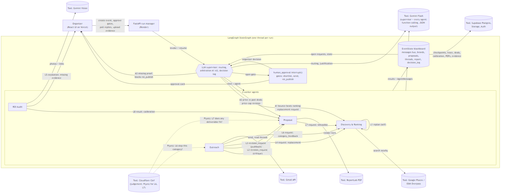
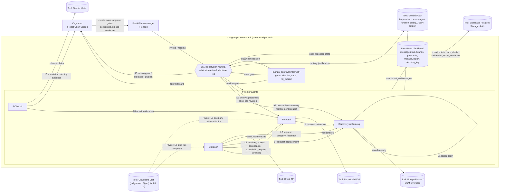
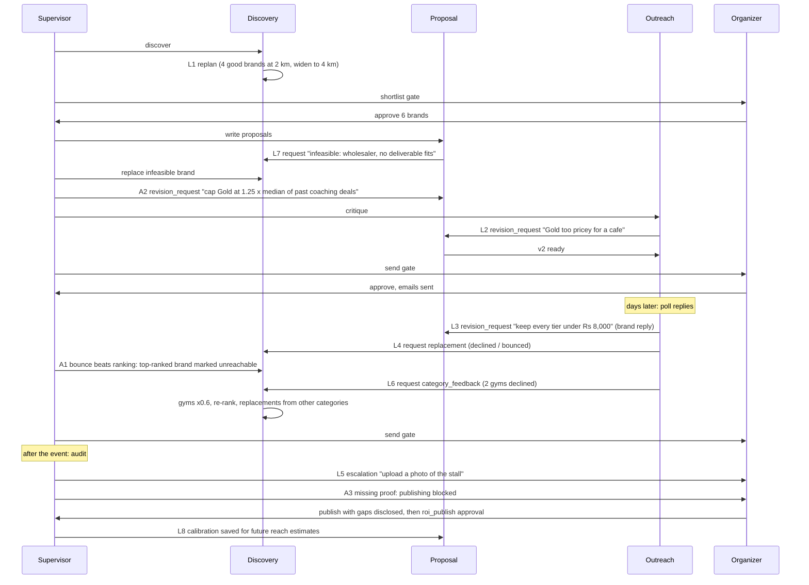

# Paytriq: design document

Team BugOut: Archisha Yadav, Aryan Srivastava, Aarohi Kondpalle, Aditi Padole.

Paytriq is **4 worker agents + an LLM supervisor that routes, arbitrates conflicts and justifies every decision**,
built with LangGraph as an **orchestrator-worker (supervisor) pattern over a shared blackboard**.

## 1. Problem and scope

Event organizers at Indian colleges (fest cores, clubs, hackathon teams) raise sponsorship mostly through manual
cold emails with very low reply rates, while local businesses within about 2 km of campus (cafes, gyms, coaching
centres, salons) want measurable access to students but rarely get proof of delivery. Paytriq finds and ranks those
businesses, writes brand-specific tiered proposals, runs the email outreach including negotiation, and after the
event audits the promised deliverables to produce an ROI report.

**Changes since the approved proposal** (also noted in the synopsis):

- The CA2 review called the design "a largely linear pipeline" (section 10). We added **eight explicit coordination
  loops** (L1-L8, section 5) in which agents critique each other, request revisions, hand work back and replan;
  **three arbitration rules** (A1-A3, section 5.1) with which the supervisor settles conflicts between agents; a
  **decision log** in which the supervisor records and justifies every routing decision, guardrail hit and
  arbitration; and an LLM supervisor that chooses the next agent at every step instead of a fixed order.
- Gemini 1.5 Flash has been retired; the model is configurable through `GEMINI_MODEL`, defaulting to the
  `gemini-flash-latest` alias.
- Discovery falls back to OpenStreetMap (Overpass API) when Google Places is not configured or fails. This keeps
  the system at zero infrastructure cost.
- A demo-mode email redirect (`DEMO_MODE=true`) sends all outgoing email to team inboxes, so no real business is
  emailed during evaluation.
- A **demo mode with a fixture world** (section 9): fixture businesses, inbox and evidence photos, with real Gemini
  reasoning, so every loop and rule can be shown reliably in a few minutes. An offline **rehearsal** variant uses a
  scripted LLM for practice only and is marked as such everywhere.

## 2. Architecture

The rendered diagram comes from [architecture.mmd](architecture.mmd) (also as [SVG](architecture.svg)). Source:

**Data flow.** Every arrow from the supervisor is a decision made at run time: a routing choice by the LLM, or an
arbitration by a rule in code. Agents never call each other directly. They post `AgentMessage`s addressed to another
agent on the shared `messages` list, and the supervisor reads the open (unanswered) requests and routes to the
addressee. A request counts as answered when the addressee posts a message whose `content.in_reply_to` lists the
request id (`backend/app/graph/messages.py`).

## 3. Orchestration pattern: orchestrator-worker (supervisor) over a shared blackboard, with human gates

The system is 4 worker agents + an LLM supervisor that routes, arbitrates conflicts and justifies every decision:

- **Supervisor** (`graph/supervisor.py`): before routing it applies the arbitration rules (`graph/arbitration.py`,
  section 5.1) and the per-brand revision cap. It then gives the LLM a compact snapshot (phase, open requests per
  agent, the last 8 messages, recent errors, pending approval, ROI gaps) and gets back `{"next", "gate", "reason"}`
  as structured output. Hard guardrails in code:
  - at most 25 supervisor steps between two human or external touchpoints (then escalate to the organizer);
  - an approval gate is only opened when there is something to approve (and `roi_publish` never while proof is
    missing, unless the organizer chose to publish with the gaps disclosed);
  - the same hand-off (agent A to agent B) at most 3 times since the last human input (then escalate);
  - at most 2 agent-initiated revision requests per brand; a third puts the brand `on_hold` and escalates to the
    organizer (organizer requests are never capped);
  - emails are never sent without an approved send gate (enforced inside Outreach's send tool).
  If the LLM is unavailable, a deterministic fallback route is used and the trace records `source: "fallback"`.
- **Decision log**: every routing decision, guardrail hit and arbitration is appended to `EventState.decision_log`
  as `{ts, kind (route, guardrail, arbitration), next, reason, source (llm, fallback, code), ...}` and written to the
  trace as a `decision` event.
- **Blackboard**: `EventState` (`graph/state.py`) holds the shared data and the message bus. It is checkpointed by
  LangGraph (Postgres in deployment), so paused runs survive restarts.
- **Human-in-the-loop**: `human_approval` calls `interrupt()`; `POST /runs/{id}/approve` resumes the graph. There
  are three gates: `shortlist`, `send` and `roi_publish`. A rejection does not stop the run. It becomes work for an
  agent (for example, organizer feedback on the shortlist becomes a `request` to Discovery).

**Why this pattern.** The work has a natural order (find, pitch, send, audit), but the interesting cases do not:
a critique sends work back to Proposal, a decline sends work back to Discovery, a missing photo sends a question to
the organizer. A peer-to-peer design would make these loops hard to bound. A fixed pipeline cannot express them.
A supervisor over a blackboard keeps one place for routing decisions, arbitration and guardrails while letting any
agent ask any other agent for work. It also produces a single readable trace.

**Run segments.** Sponsorship takes days, so a run is a sequence of segments on the same LangGraph thread:
(1) start, which runs until the shortlist and then the send gate; (2) `poll-replies`, which handles replies and may
loop back to Proposal and Discovery; (3) `audit`, which runs the ROI audit and, once publishing is unblocked, the
publish gate. Each segment begins with a message from the organizer on the bus, so it is visible in the trace.

## 4. Agents

Every agent is a LangGraph node `async def run(state, deps) -> dict`. Inside, it runs its **own reasoning loop**
(`agents/loop.py`): the LLM sees the task context plus all observations so far, picks one tool by **function
calling** with a one-sentence reasoning, the tool runs through `call_tool` (timeout, one retry with backoff,
structured error), and the observation is fed back. The loop ends when the LLM calls `finish` or after 6 tool calls.
Tool failures are observations, so the LLM can choose an alternative.

| Agent | Responsibility | Tools (LLM chooses) | Adaptation | Fails gracefully by |
|---|---|---|---|---|
| **Discovery & Ranking** (`agents/discovery.py`) | Find businesses near campus, score fit for the audience, find replacements | `search_places`, `score_brands`, `find_contact`, plus `list_alternatives`, `pick_replacement` in replacement mode | **L1**: if fewer than 5 brands score >= 0.6, LLM plans a replan (radius up to 4 km, adjacent categories) and posts a `replan` message; max 2 replans. **L4/L7**: one replacement per open replacement or infeasible request. **L6**: on category feedback, scores of that category x0.6, re-rank, top up to the organizer's shortlist size from other categories. Uses organizer feedback when the shortlist is rejected. | Places falls back from Google to OpenStreetMap (and a mirror); if nothing at all is found it escalates to the organizer |
| **Proposal** (`agents/proposal.py`) | Brand-specific pitch, Bronze/Silver/Gold tiers, expected reach, PDF | `draft_proposal`, `check_pricing`, `render_pdf` | Handles `revision_request`s from Outreach (critique, brand pushback), the supervisor (A2 price cap) and the organizer; produces v2, v3; redrafts when `check_pricing` warns. **L7**: before any PDF, asks Clef whether any deliverable fits the brand and checks Bronze cost per person reached in code; hands infeasible brands back to Discovery. **L8**: scales expected reach by the organizer's calibration factor and says so (`reach_note`). | Hard price caps enforced in code; template proposal if the LLM is down |
| **Outreach** (`agents/outreach.py`) | Critique before sending, send approved emails, read and classify replies, decide next action | `critique_proposals`, `request_revision`, `prepare_emails`, `send_approved`, `poll_replies`, `classify_replies`, `route_pushback`, `request_replacement`, `mark_accepted`, `draft_nudge` | **L2** critique to revision (max 1 per brand); **L3** pushback routed with the brand's constraint; **L4** decline or bounce to Discovery; nudges silent threads; records every outcome per brand; **L6** at 2 negative outcomes in a category asks Clef whether to stop prioritising it, and tells Discovery on yes; remembers accepted deals for A2 | Gmail failure keeps the draft and escalates; approved emails are still sent if the LLM is down; a failed deal write never blocks an acceptance |
| **ROI Audit** (`agents/roi_audit.py`) | Verify each promised deliverable against photos and links | `list_deliverables`, `verify_brand` (Gemini Vision), `request_evidence`, `compile_report` | **L5**: missing or ambiguous evidence leads to an `escalation` asking for specific extra evidence; gaps are disclosed, never rounded up. **L8**: computes a reach factor per sponsor, saved for Proposal only on approval, and only from sponsors whose deliverables were all verified (unverified evidence is not "delivered nothing", so it never changes future estimates) | Every sponsor is verified even if the LLM skips one; a failed vision call becomes "ambiguous, needs a manual look" |
| **LLM supervisor** (`graph/supervisor.py`, `graph/arbitration.py`) | Choose the next agent or gate; arbitrate conflicts; justify every decision | structured output `RouteDecision`; `Justification` for arbitration | **A1-A3** arbitration rules; **decision log** of every route, guardrail and arbitration; per-brand **revision cap** (2 agent-initiated requests); re-routes on open requests, escalates on loops or step budget | Deterministic fallback route; template justification when the LLM is down |

**Memory.** Short-term memory is the per-turn observation list in the reasoning loop. Long-term memory is the
checkpointed `EventState` (previous proposal versions, thread histories including seen Gmail message ids, per-brand
outcomes, previous ROI gaps, the decision log and the full message history) plus two per-organizer tables that
outlive a run: accepted deals (`sponsor_deals`, used by A2) and reach calibration (`reach_calibration`, used by L8).

**Model choice per agent.** All agents and the supervisor use the same Gemini Flash model (`GEMINI_MODEL`, default
`gemini-flash-latest`). The tasks are short structured decisions where latency and free-tier cost matter more than
peak reasoning, Flash supports function calling, JSON schema output and images in one API, and a single model keeps
behaviour consistent. The model can be changed in one environment variable if a task needs a stronger one.
Two narrow yes/no judgements (L6, L7) go to Cloudflare Clef instead (section 5.2).

## 5. Coordination loops (what makes this more than a pipeline)

| Loop | Trigger | Message on the bus | Bound |
|---|---|---|---|
| L1 self-replan | < 5 brands with fit >= 0.6 | `discovery -> discovery` `replan` | 2 replans, radius <= 4 km |
| L2 critique | Outreach judges tone, length or price wrong | `outreach -> proposal` `revision_request` (`source: critique`) | 1 per brand |
| L3 pushback | Reply classified `pushback_price` or `pushback_deliverables` | `outreach -> proposal` `revision_request` (`source: brand_reply`) | revision cap, organizer re-approves |
| L4 replacement | Reply `declined` or bounce | `outreach -> discovery` `request` (`reason: replacement`) | one replacement per request; unused brands only; escalates if none |
| L5 evidence | Deliverable missing, ambiguous or not verified | `roi_audit -> human` `escalation` | then arbitration A3 |
| L6 category feedback | 2 negative outcomes (declined, bounced, silent after a nudge) in one category trigger a Clef question; sent only if Clef (or the rule fallback) says stop prioritising it | `outreach -> discovery` `request` (`reason: category_feedback`, `p_yes`, `decided_by`) | once per category; a "no" is re-asked only after a new negative; scores x0.6 |
| L7 infeasible | Clef judges that no deliverable fits the brand (rule fallback: wholesale, industrial, warehouse), or Bronze costs more than Rs 50 per person reached (code) | `proposal -> discovery` `request` (`reason: infeasible`; `p_yes`, `decided_by` when the fit judgement decided) | no PDF rendered; brand replaced |
| L8 calibration | Organizer approves publishing an ROI report | `roi_audit -> proposal` `result` (`reason: calibration`); for a category with no fully verified sponsor, `result` (`reason: calibration_skipped`, unverified count) instead | saved only on approval, and only from sponsors whose deliverables were all verified; running average per organizer and category |

All eight loops and three rules are exercised by the test suite (`backend/tests`, including an end-to-end run of
the demo scenario) and are labelled on the Trace page, the event page's activity timeline and its graph view.

### 5.1 Arbitration (A1-A3)

Conflicts between agents are resolved by a fixed rule in code, so the outcome is predictable and testable. Gemini
writes a one-to-two-sentence justification for the organizer; if Gemini fails, a template sentence is used. Each
arbitration is a `decision_log` entry `{kind: "arbitration", rule, conflict, agents, resolution, justification}`
and a `decision` trace event.

| Rule | Conflict | Rule and threshold | Resolution | Fallback |
|---|---|---|---|---|
| **A1 bounce vs ranking** | Discovery ranked a brand in its top 3, but Outreach's email to it bounced | top 3 by fit score | Delivery evidence beats ranking: brand marked `unreachable`; Discovery gets a `request` (`reason: replacement`, `arbitration: A1`) unless Outreach already asked | template justification |
| **A2 price vs past deals** | A new proposal's highest price is above what this organizer's sponsors in that category accepted | price > 1.25 x median of accepted deals (`sponsor_deals`, same owner and category), only with >= 3 deals | Cap every tier at 1.25 x median; Proposal gets a `revision_request` (`source: arbitration`) | fewer than 3 deals: logged as "insufficient data", price left alone |
| **A3 ROI gaps vs publishing** | ROI Audit found missing or ambiguous proof, but the report is ready to publish | any disclosed gap | Publishing blocked (phase `roi_blocked`), "missing proof" escalation naming each brand and deliverable. Reopens only when a re-audit finds no gaps, or the organizer explicitly chooses "Publish with gaps disclosed"; the normal `roi_publish` approval still follows. Never published silently | template justification |

The revision cap (2 agent-initiated revision requests per brand, A2 included) is the supervisor's guardrail against
agents negotiating forever; organizer requests are not counted.

### 5.2 Judgement layer (Clef)

Two loop decisions are judgement calls rather than routing or arithmetic, and a hard-coded list answered them badly
(a category list cannot know that one wholesaler sells snacks to hostels). They go to **Cloudflare Clef**
(`clef-flash` on Workers AI, `backend/app/core/clef.py`), a decision model that answers typed questions about a JSON
state with a calibrated probability and writes no text:

| Loop | Asked by | Question (`noul`, yes/no) | State sent | Old rule (fallback) |
|---|---|---|---|---|
| L7 | Proposal, once per new brand, before any LLM call | "Can any typical student-event sponsorship deliverable (logo on banners, stall, social media posts, discount coupons for students) realistically bring this business customers or brand value?" | brand name, category, address, website, fit reason; event name, type, college, audience, footfall | category not in wholesale, industrial, warehouse |
| L6 | Outreach, when a category reaches 2 negative outcomes | "Given these outcomes, should we stop prioritising this business category for this event?" | category, negative evidence (brand, outcome), positive outcomes in that category, event audience | yes |

**Clef judges; code only guards the decision** (`judge()`): P(yes) >= 0.75 is yes, <= 0.25 is no. In between, Clef is
unsure, so the old rule's answer is applied and the organizer gets an `escalation` (`reason: clef_unsure`, with
`p_yes`). If Clef is not configured, times out (10 s, one retry on 429/5xx) or errors, the rule decides
(`source: rule_fallback`); a Clef failure never stops a run. The arithmetic half of L7 (Bronze cost per person
reached) and the L6 trigger count stay in code. Every judgement writes one `decision` trace event with
`kind: "clef_judgement"` (purpose, question, p_yes, thresholds, answer, source, escalated, rule_answer), and the
resulting `category_feedback` / `infeasible` requests carry `p_yes` and `decided_by`. When Clef says "keep this
category", Outreach records it in its step result (`content.category_checks`) and asks again only after a new
negative outcome in that category.

**Why only these two.** Supervisor routing, arbitration justifications, critiques and reply classification stay on
Gemini: their written reasons are trace evidence that the agents reasoned, and Clef returns only numbers. Clef is
used where a calibrated yes/no is the whole answer and a threshold plus a human check is the right guard.

## 6. Robustness

- **Input validation**: Pydantic models on every endpoint (`EventCreate`, `ApprovalRequest`, `AuditRequest`, evidence
  form); clear 4xx messages (422 invalid fields, 404 not found or not owned, 409 run busy, wrong gate or nothing to
  unblock, 413/415 for bad photos).
- **Tool failures**: `tools/base.py::call_tool` adds a timeout and one retry with backoff, then returns a structured
  error that is traced and given to the agent, which reasons about an alternative.
- **LLM failures**: Gemini calls retry on 429/5xx; if still failing, the supervisor uses the fallback route,
  arbitration uses template justifications, Proposal uses a template, Outreach still sends already-approved emails,
  and ROI marks items for manual review.
- **Clef failures**: L6 and L7 fall back to the old rules (`source: rule_fallback` in the trace).
- **Memory failures**: a failed deal or calibration write is traced and never blocks an acceptance or a publish.
- **Run failures**: the run manager catches everything, stores `last_error`, and the UI offers "Continue run".

## 7. Technology choices

| Choice | Why |
|---|---|
| LangGraph (StateGraph, `Command`, `interrupt`, Postgres checkpointer) | Real agent framework with first-class human-in-the-loop and durable state; supervisor routing via `Command(goto=...)` |
| Gemini Flash (`gemini-flash-latest`) via `google-genai` | Free tier, function calling, JSON schema output and vision in one model |
| Cloudflare Clef (`clef-flash`, Workers AI REST) | Calibrated yes/no probabilities for the two judgement calls (L6, L7); cheap and fast; a threshold and a rule fallback make it safe |
| FastAPI + Pydantic v2 | Typed request validation, async I/O for long agent runs |
| Supabase (Postgres, Auth, Storage) | Zero-cost managed database, JWT auth and file storage; RLS for browser access |
| React + Vite + Tailwind | Simple SPA with a calm, consistent UI |
| OpenStreetMap Overpass (Google Places optional) | Free, no billing account; Google improves coverage when available |
| Gmail API with refresh token | Real threads and replies for a dedicated demo sender |
| ReportLab (and Pillow for demo evidence images) | Deterministic, dependency-light PDFs and images |
| Render (API) and Vercel (UI) | Free tiers, Git-based deploys |

## 8. Data model

- `events` (owner, name, college, date, footfall, audience, budget goal, lat/lng, `demo_scenario`: null, `demo` or
  `rehearsal`)
- `runs` (event, owner, status, phase, pending gate, last error)
- `agent_trace` (run, ts, agent, event_type, payload JSON): every message, tool call, error, interrupt and supervisor
  `decision`
- `evidence` (run, brand, photo path or link, note)
- `sponsor_deals` (owner, event, brand, category, tier, final price, accepted_at): accepted-deal memory for A2
- `reach_calibration` (owner, category, factor, n_events, updated_at; primary key owner + category): L8 memory,
  written only on approval, and only from sponsors whose deliverables were all verified
- LangGraph checkpoint tables (`EventState` per run thread)

New `EventState` fields: `decision_log`, `feedback` (per-brand outcomes), `revision_count`, `publish_with_gaps`,
`target_brand_count`, `actual_footfall`; `Brand.unreachable` (A1); `Proposal.reach_note` (L8); proposal statuses
`on_hold` (revision cap) and `infeasible` (L7); run phase `roi_blocked` (A3).

Schemas and samples: [io-definitions.md](io-definitions.md).

## 9. Known limitations

- **Demo mode uses a fixture world.** Demo events run against fixture businesses, a scripted inbox and generated
  evidence photos (`backend/app/demo/world.py`), with **real Gemini reasoning** for every agent and supervisor
  decision. The world is designed so each loop's trigger appears reliably; the agents' responses are not scripted.
  Two loops still depend on Gemini's own judgement in a live demo: A1 fires only if Gemini ranks the bouncing cafe
  in its top 3, and L2 depends on Outreach's critique. L7 needs the organizer to tick the wholesaler at the shortlist
  gate. With Clef configured, L6 and L7 also depend on Clef's judgement: if Clef decides the wholesaler fits, or
  that gyms should stay prioritised, that loop does not fire in that run (the `clef_judgement` entry shows why). Calibration saved from a demo run stays in that organizer's calibration table.
  In the submitted run the evidence was placeholder graphics, so 0 of 15 deliverables were verified. That run
  predates the fix that calibrates only from fully verified sponsors and saved x0.00 factors, which this fix now
  prevents.
- **Rehearsal mode is scripted.** Rehearsal events use scripted stand-ins for Gemini and Clef, for offline practice only.
  Every trace entry is marked "rehearsal — not real reasoning", and the export file is named
  `REHEARSAL-NOT-FOR-SUBMISSION-...`. Rehearsal traces are never submitted or committed to `traces/`.
- Reply polling is on demand (`POST /runs/{id}/poll-replies`), not scheduled.
- The Render free tier sleeps when idle; the first request after sleeping is slow.
- Gemini's free tier is rate limited; a full first segment makes roughly 30 to 50 LLM calls.

## 10. Response to the CA2 review

The CA2 review (Exam Studio, approved project page) said:

> "The architecture reads as a largely linear pipeline (discover -> propose -> outreach -> audit), gated by human
> approval at each stage rather than agents reasoning about or reacting to each other's output -- there's no
> described example of, say, the Outreach Agent's findings changing what the Proposal Agent does next, or any
> conflict/arbitration between agents the way the strongest resubmissions in this batch demonstrate."

Paytriq now has eight loops in which one agent's output changes what another does, and three conflicts the
supervisor arbitrates (sections 5 and 5.1). Four examples from the submitted real trace
(`traces/2026-10-21-demo-mode-full-run.json`, run `4961225e-639a-4fad-a50d-8097ab27fe1e`):

1. **Outreach's findings change what Proposal does next (L3).** Bean Theory Cafe replied that Rs 8,000 was the most
   it could spend. Outreach classified the reply as `pushback_price` and posted a `revision_request` with
   `source: brand_reply` (message `805fbf6e4b80`, trace #1335, 2026-10-21T18:23:19Z). Proposal answered with version 2
   under the brand's cap (result `a072f7196e66`, trace #1351, 2026-10-21T18:24:25Z: Gold Rs 8,000 / Silver Rs 5,500 /
   Bronze Rs 3,000), and the organizer approved the revised email at the send gate.
2. **A bounce overrides Discovery's ranking (A1).** Discovery ranked Chai Junction Cafe first with fit 0.95 (result
   `6d13b7961955`, trace #1205, 2026-10-21T17:11:35Z), but Outreach's email to it bounced. The supervisor's rule A1
   marked it unreachable and the replacement went ahead (arbitration trace #1341, 2026-10-21T18:23:46Z: "Delivery
   evidence beats ranking: Chai Junction Cafe marked unreachable; Outreach's replacement request stands.";
   L4 request `ec7fc36b0569`, trace #1339, 2026-10-21T18:23:38Z).
3. **The supervisor caps a price against past deals (A2).** Proposal priced Apex Coaching Classes up to Rs 50,000,
   while this organizer's three past coaching deals had a median of Rs 10,000. A2 capped every tier at 1.25 x the
   median and sent a `revision_request` with `source: arbitration` (arbitration trace #1262, 2026-10-21T18:16:15Z;
   revision_request `84451195101a`, trace #1263), and Proposal produced a capped version (result `e7f4dc0914bc`,
   trace #1276, 2026-10-21T18:16:52Z: v2 Gold Rs 12,000 / Silver Rs 8,500 / Bronze Rs 5,000).
4. **Outcomes change what Discovery looks for (L6).** After PulseFit Gym and IronCore Gym both declined, Clef judged
   that gyms should stop being prioritised (p_yes 0.90, trace #1455) and Outreach sent `category_feedback` to
   Discovery (request `a6b3d775378d`, trace #1456). Discovery scaled gym scores by 0.6 and re-ranked (result
   `266bfed371dd`, trace #1460), then picked Page Turner Books, a bookstore, as the replacement (result
   `5dd91ac94f6a`, trace #1466, 2026-10-21T18:36:45Z).

Ids and timestamps above are filled in from `python backend/scripts/verify_trace.py traces/<file>.json` on the
committed trace; nothing in this section is written from memory.
