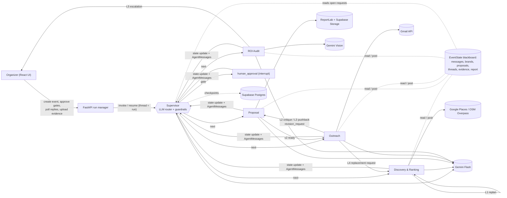
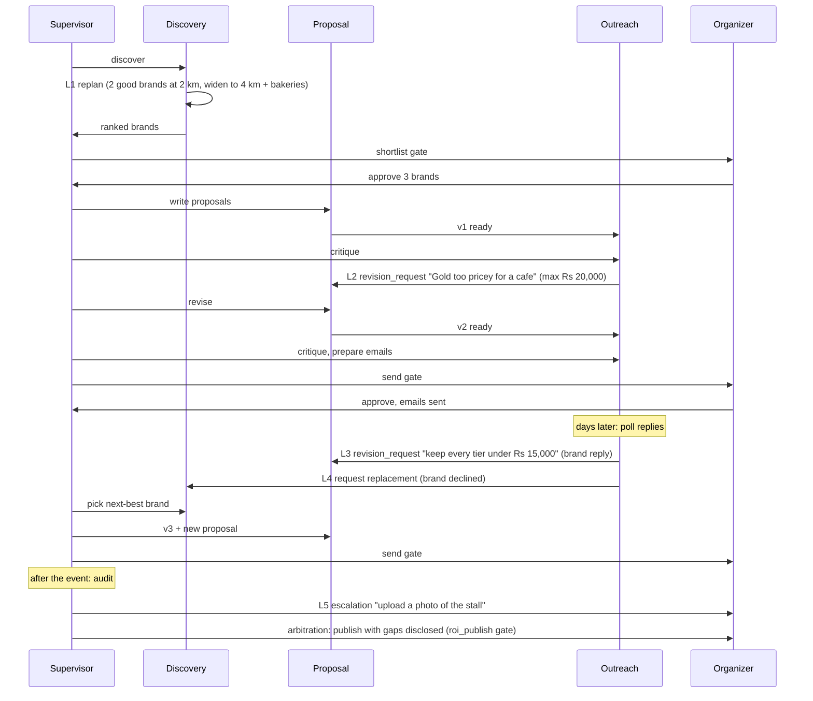

# Paytriq: design document (first draft)

Team BugOut: Archisha Yadav, Aryan Srivastava, Aarohi Kondpalle, Aditi Padole.

## 1. Problem and scope

Event organizers at Indian colleges (fest cores, clubs, hackathon teams) raise sponsorship mostly through manual
cold emails with very low reply rates, while local businesses within about 2 km of campus (cafes, gyms, coaching
centres, salons) want measurable access to students but rarely get proof of delivery. Paytriq finds and ranks those
businesses, writes brand-specific tiered proposals, runs the email outreach including negotiation, and after the
event audits the promised deliverables to produce an ROI report.

**Changes since the approved proposal** (also noted in the synopsis):

- The CA2 review called the design "a largely linear pipeline". We added five explicit coordination loops (section 5)
  in which agents critique each other, request revisions and replan, and an LLM supervisor that chooses the next agent
  at every step instead of a fixed order.
- Gemini 1.5 Flash has been retired; the model is configurable through `GEMINI_MODEL`, defaulting to the
  `gemini-flash-latest` alias.
- Discovery falls back to OpenStreetMap (Overpass API) when Google Places is not configured or fails. This keeps
  the system at zero infrastructure cost.
- A demo mode redirects all outgoing email to team inboxes, so no real business is emailed during evaluation.

## 2. Architecture

A more detailed version of this diagram is in [architecture.mmd](architecture.mmd).

**Data flow.** Every arrow from the supervisor is a routing decision made by the LLM at run time. Agents never call
each other directly. They post `AgentMessage`s addressed to another agent on the shared `messages` list, and the
supervisor reads the open (unanswered) requests and routes to the addressee. A request counts as answered when the
addressee posts a message whose `content.in_reply_to` lists the request id (`backend/app/graph/messages.py`).

## 3. Orchestration pattern: supervisor + blackboard, with human gates

We use an **orchestrator-worker (supervisor) pattern over a shared blackboard**:

- **Supervisor** (`graph/supervisor.py`): an LLM router that receives a compact snapshot (phase, open requests per
  agent, the last 8 messages, recent errors, pending approval, ROI gaps) and returns
  `{"next", "gate", "reason"}` as structured output. Hard guardrails in code:
  - at most 25 supervisor steps between two human or external touchpoints (then escalate to the organizer);
  - an approval gate is only opened when there is something to approve;
  - the same hand-off (agent A to agent B) at most 3 times since the last human input (then escalate);
  - emails are never sent without an approved send gate (enforced inside Outreach's send tool).
  If the LLM is unavailable, a deterministic fallback route is used and the trace records `source: "fallback"`.
- **Blackboard**: `EventState` (`graph/state.py`) holds the shared data and the message bus. It is checkpointed by
  LangGraph (Postgres in deployment), so paused runs survive restarts.
- **Human-in-the-loop**: `human_approval` calls `interrupt()`; `POST /runs/{id}/approve` resumes the graph. A
  rejection does not stop the run. It becomes work for an agent (for example, organizer feedback on the shortlist
  becomes a `request` to Discovery).

**Why this pattern.** The work has a natural order (find, pitch, send, audit), but the interesting cases do not:
a critique sends work back to Proposal, a decline sends work back to Discovery, a missing photo sends a question to
the organizer. A peer-to-peer design would make these loops hard to bound. A fixed pipeline cannot express them.
A supervisor over a blackboard keeps one place for routing decisions and guardrails while letting any agent ask any
other agent for work. It also produces a single readable trace.

**Run segments.** Sponsorship takes days, so a run is a sequence of segments on the same LangGraph thread:
(1) start, which runs until the shortlist and then the send gate; (2) `poll-replies`, which handles replies and may
loop back to Proposal and Discovery; (3) `audit`, which runs the ROI audit and the publish gate. Each segment begins
with a message from the organizer on the bus, so it is visible in the trace.

## 4. Agents

Every agent is a LangGraph node `async def run(state, deps) -> dict`. Inside, it runs its **own reasoning loop**
(`agents/loop.py`): the LLM sees the task context plus all observations so far, picks one tool by **function
calling** with a one-sentence reasoning, the tool runs through `call_tool` (timeout, one retry with backoff,
structured error), and the observation is fed back. The loop ends when the LLM calls `finish` or after 6 tool calls.
Tool failures are observations, so the LLM can choose an alternative.

| Agent | Responsibility | Tools (LLM chooses) | Adaptation | Fails gracefully by |
|---|---|---|---|---|
| **Discovery & Ranking** (`agents/discovery.py`) | Find businesses near campus, score fit for the audience, find replacements | `search_places`, `score_brands`, `find_contact`, plus `list_alternatives`, `pick_replacement` in replacement mode | **L1**: if fewer than 5 brands score >= 0.6, LLM plans a replan (radius up to 4 km, adjacent categories) and posts a `replan` message; max 2 replans. Uses organizer feedback when the shortlist is rejected. | Places falls back from Google to OpenStreetMap (and a mirror); if nothing at all is found it escalates to the organizer |
| **Proposal** (`agents/proposal.py`) | Brand-specific pitch, Bronze/Silver/Gold tiers, expected reach, PDF | `draft_proposal`, `check_pricing`, `render_pdf` | Handles `revision_request`s from Outreach (critique, brand pushback) and the organizer; produces v2, v3; redrafts when `check_pricing` warns | Hard price caps enforced in code; template proposal if the LLM is down |
| **Outreach** (`agents/outreach.py`) | Critique before sending, send approved emails, read and classify replies, decide next action | `critique_proposals`, `request_revision`, `prepare_emails`, `send_approved`, `poll_replies`, `classify_replies`, `route_pushback`, `request_replacement`, `mark_accepted`, `draft_nudge` | **L2** critique to revision (max 1 per brand); **L3** pushback routed with the brand's constraint; **L4** decline or bounce to Discovery; nudges silent threads | Gmail failure keeps the draft and escalates; approved emails are still sent if the LLM is down |
| **ROI Audit** (`agents/roi_audit.py`) | Verify each promised deliverable against photos and links | `list_deliverables`, `verify_brand` (Gemini Vision), `request_evidence`, `compile_report` | **L5**: missing or ambiguous evidence leads to an `escalation` asking for specific extra evidence; gaps are disclosed, never rounded up | Every sponsor is verified even if the LLM skips one; a failed vision call becomes "ambiguous, needs a manual look" |
| **Supervisor** (`graph/supervisor.py`) | Choose the next agent or gate; arbitrate L5 | structured output `RouteDecision` | Re-routes on open requests, escalates on loops or step budget | Deterministic fallback route |

**Memory.** Short-term memory is the per-turn observation list in the reasoning loop. Long-term memory is the
checkpointed `EventState`: previous proposal versions, thread histories (including seen Gmail message ids),
previous ROI gaps (fed to the next audit) and the full message history.

**Model choice per agent.** All agents use the same Gemini Flash model (`GEMINI_MODEL`). The tasks are short
structured decisions where latency and free-tier cost matter more than peak reasoning, Flash supports function
calling, JSON schema output and images in one API, and a single model keeps behaviour consistent. The model can be
changed in one environment variable if a task needs a stronger one.

## 5. Coordination loops (what makes this more than a pipeline)

| Loop | Trigger | Message on the bus | Bound |
|---|---|---|---|
| L1 self-replan | < 5 brands with fit >= 0.6 | `discovery -> discovery` `replan` | 2 replans, radius <= 4 km |
| L2 critique | Outreach judges tone, length or price wrong | `outreach -> proposal` `revision_request` (`source: critique`) | 1 per brand |
| L3 pushback | Reply classified `pushback_price` or `pushback_deliverables` | `outreach -> proposal` `revision_request` (`source: brand_reply`) | pair-loop guardrail, organizer re-approves |
| L4 replacement | Reply `declined` or bounce | `outreach -> discovery` `request` (`reason: replacement`) | unused brands only; escalates if none |
| L5 evidence | Deliverable missing, ambiguous or not verified | `roi_audit -> human` `escalation`; supervisor `decision` arbitrates | organizer decides at `roi_publish` |

All five are exercised by `backend/tests/test_integration.py` and are labelled in the Trace page.

## 6. Robustness

- **Input validation**: Pydantic models on every endpoint (`EventCreate`, `ApprovalRequest`, evidence form);
  clear 4xx messages (422 invalid fields, 404 not found or not owned, 409 run busy or wrong gate, 413/415 for bad photos).
- **Tool failures**: `tools/base.py::call_tool` adds a timeout and one retry with backoff, then returns a structured
  error that is traced and given to the agent, which reasons about an alternative.
- **LLM failures**: Gemini calls retry on 429/5xx; if still failing, the supervisor uses the fallback route,
  Proposal uses a template, Outreach still sends already-approved emails, and ROI marks items for manual review.
- **Run failures**: the run manager catches everything, stores `last_error`, and the UI offers "Continue run".

## 7. Technology choices

| Choice | Why |
|---|---|
| LangGraph (StateGraph, `Command`, `interrupt`, Postgres checkpointer) | Real agent framework with first-class human-in-the-loop and durable state; supervisor routing via `Command(goto=...)` |
| Gemini Flash via `google-genai` | Free tier, function calling, JSON schema output and vision in one model |
| FastAPI + Pydantic v2 | Typed request validation, async I/O for long agent runs |
| Supabase (Postgres, Auth, Storage) | Zero-cost managed database, JWT auth and file storage; RLS for browser access |
| React + Vite + Tailwind | Simple SPA with a calm, consistent UI |
| OpenStreetMap Overpass (Google Places optional) | Free, no billing account; Google improves coverage when available |
| Gmail API with refresh token | Real threads and replies for a dedicated demo sender |
| ReportLab | Deterministic, dependency-light PDFs |
| Render (API) and Vercel (UI) | Free tiers, Git-based deploys |

## 8. Data model

- `events` (owner, name, college, date, footfall, audience, budget goal, lat/lng)
- `runs` (event, owner, status, phase, pending gate, last error)
- `agent_trace` (run, ts, agent, event_type, payload JSON): every message, tool call, error, interrupt
- `evidence` (run, brand, photo path or link, note)
- LangGraph checkpoint tables (`EventState` per run thread)

Schemas and samples: [io-definitions.md](io-definitions.md).

## 9. Known limitations

- Reply polling is on demand (`POST /runs/{id}/poll-replies`), not scheduled.
- The Render free tier sleeps when idle; the first request after sleeping is slow.
- Gemini's free tier is rate limited; a full first segment makes roughly 30 to 50 LLM calls.
